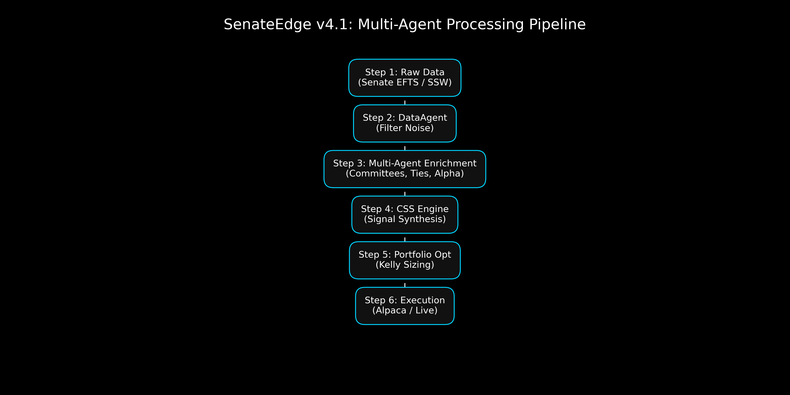

# SenateTrades

A multi-agent system that analyzes U.S. senators' stock-trade disclosures. The question behind it:
do senators trade better in the sectors their committees oversee? It scores each disclosure, generates
buy/sell signals, and can paper-trade them through Alpaca.



## Agents

`orchestrator.py` runs a pipeline of single-purpose agents:

| Agent | Job |
|---|---|
| `data_agent` | Fetch and normalize disclosures (Senate Stock Watcher, official EFTS, or Quiver Quant) |
| `committee_agent` | Map each senator's committees and subcommittees to the sectors they oversee |
| `performance_agent` | Per-senator, per-sector historical alpha |
| `profile_agent` | Trading profile for each senator |
| `ties_agent` | Geographic, political and relationship ties between a senator and a company |
| `bill_agent` | Track pending legislation (congress.gov) that could move a sector |
| `prediction_agent` | Upstream signals: likely trades *before* they are filed |
| `signal_agent` | Weighted composite score, plus momentum |
| `model_agent` | Learns the composite weights with a small linear layer (PyTorch) |
| `quant_agent` / `risk_agent` | Entry/exit mechanics and ATR-based position sizing |
| `backtest_agent` | Replays the pipeline on history |
| `execution_agent` | Places paper (default) or live orders via Alpaca |

Weights, thresholds and committee-to-sector maps live in `config.py`.

## Run

```bash
pip install -r requirements.txt
cp .env.example .env              # add keys: Anthropic, congress.gov, optional Alpaca / Quiver
python orchestrator.py --dry-run  # print signals, place no orders
python orchestrator.py --backtest --years 2
python orchestrator.py --live     # paper trading via Alpaca
```

`scripts/` regenerates the figures in `outputs/` and `visuals/`.

## Caveats

Disclosures are filed up to 45 days after the trade, so "copying" them always arrives late. The
prediction agent exists because of that lag. The backtest has not been checked for look-ahead or
survivorship bias, so its returns are not reported here. Research project, not financial advice.

## Tech

Python · pandas · yfinance · PyTorch · Anthropic API · congress.gov API · Alpaca
